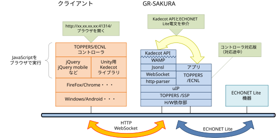
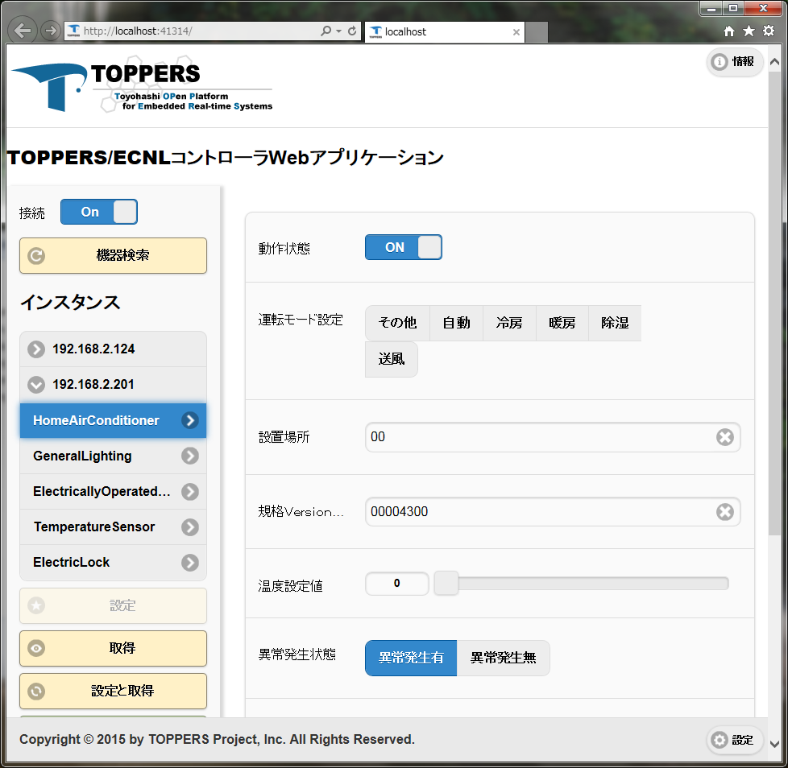
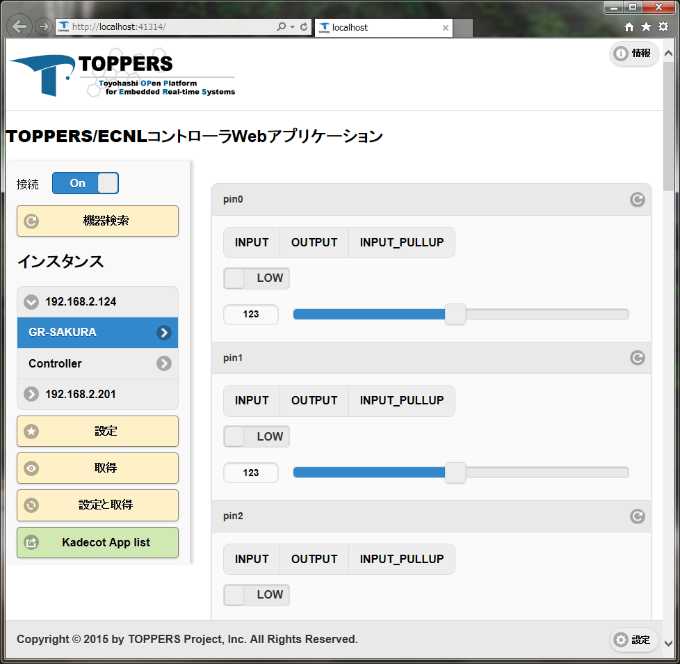
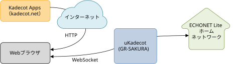
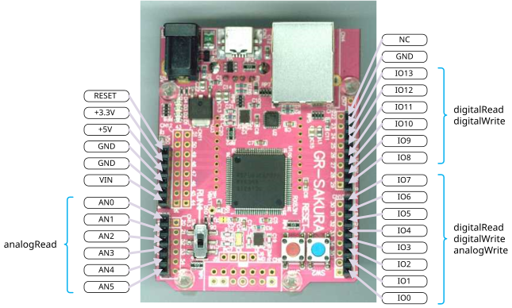
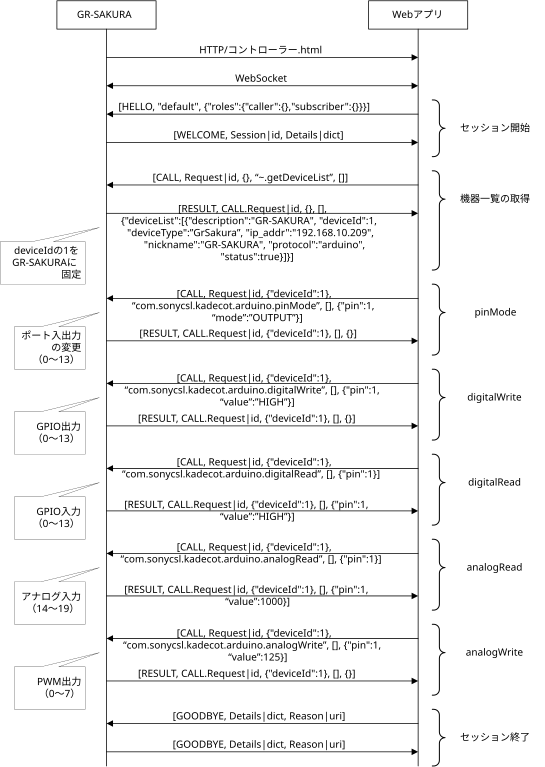

# TOPPERS/μKadecot


TOPPERS/μKadecotは、ECHONET Lite 通信ミドルウェアTOPPERS/ECNLのサンプル アプリケーションです。<br>

GR-SAKURAにECHONET Lite コントローラをWebアプリケーションとして実装しています。<br>


Webアプリケーションは、WebサーバとWebブラウザの間で通信が必要になりますが、[Kadecot](http://kadecot.net/)[※](#kadecotlicense)のWebAPIと互換性を持たせているので、Kadecotアプリが使用できます。<br>

また、GR-SAKURAのGPIOを操作するWebAPIも追加し、WebアプリケーションからGPIOを操作できるようになっています。

## ダウンロード


ソースコードは[GitHubリポジトリ](https://github.com/h7ga40/uKadecot)から取得できます。「Code」→「Download ZIP」でダウンロードしてください。

書き込みイメージは[csp/flash/](csp/flash/)の `ukadecot_*.mot` をダウンロードしてください。元Wikiの拡張子表記は `.mod` ですが、SVNに格納されている実ファイルは `.mot` です。

## 使い方


使い方についての動画があります。下記を参照してください。<br>

１．[書き込みツールインストール編](https://youtu.be/_QAuYEStkZA)<br>

２．[μKadecot書き込み編](https://youtu.be/0If9QWLXZUg)<br>

３．[ECHONET Lite機器操作編](https://youtu.be/m8NLTSEmMEY)<br>

４．[Arduino互換ピン編](https://youtu.be/LOgbiKMXgl0)<br>

５．[シリアルコンソール編](https://youtu.be/bZUMz2qr_VU)<br>


## ソフトウェアについて


一般公開しているTOPPERS/ECNLは、TOPPERS/ASPとTINETを使用していますが、このアプリケーションはTOPPERS/SSPと[μIP](https://github.com/adamdunkels/uip)を使用しています。<br>

また、このアプリケーションではDHCPクライアントを実装し、起動時にIPアドレスを取得します。

Kadecot APIはWebSocketを使用しJSONでメッセージをやり取りする[WAMP](http://wamp.ws/)が使われていますので、μIPのサンプルのWebサーバにWebSocketを必要最小限ですが実装しています。<br>

HTTPメッセージヘッダを解釈するため[http-parser](https://github.com/joyent/http-parser)を使用し、WebSocketのヘッダ情報を取得しています。<br>

Webサーバのファイルシステムに[FatFS](http://elm-chan.org/fsw/ff/00index_p.html)を使用し、GR-SAKURAの1MByteのROMの一部にファイルシステムのデータを持つように実装しています。<br>

WebSocketで通信されるのはJSONフォーマットなので、[JSONSL](https://github.com/mnunberg/jsonsl)を使用しWAMP形式のメッセージを解釈しています。<br>

WebAPIからの要求はECHONET Lite電文に置き換えられUDPで送信します。また、応答のECHONET Lite電文はKadecot APIで置き換えられWebアプリケーションに応答するようになっています。

GR-SAKURAの４つのLEDは以下のように使用しています。
- D1：LANのリンク処理時に点灯します。
- D2：LANで送受信があった時に点灯します。
- D3：DHCPサーバからIPアドレスを取得している時に点灯します。
- D4：ECHONET Lite機器としての動作状態プロパティがONの時に点灯します。

初期状態では、Pin0とPin1はシリアル通信ポートとなっています。
起動時に以下のような表示が出ます。
```text
TOPPERS/SSP Kernel 1.3.0  for GR-SAKURA (Jun 14 2015 , 21:26:53)
Copyright (C) 2010 by Meika Sugimoto
Copyright (C) 2010 by Naoki Saito
            Nagoya Municipal Industrial Research Institute, JAPAN
Copyright (C) 2010 by Witz Corporation, JAPAN
Copyright (C) 2011 by Meika Sugimoto
Copyright (C) 2013 by Mitsuhiro Matsuura

mac_addr 12:34:56:78:9A:B8 default
ip_addr xx.xx.xx.xx, netmask xx.xx.xx.xx, gateway xx.xx.xx.xx
```
DHCPから取得したIPアドレスが表示されますので、そのIPアドレスにポート41314を指定して、Webブラウザに入力するとコントローラ画面が表示されます。<br>

```text
http://xx.xx.xx.xx:41314/
```
  <br>

※上の画像では`http://localhost:41314/`となっていますが、`http://xx.xx.xx.xx:41314/`となります。<br>

<br>

コントローラ画面の「Kadecot App list」を押すと、Kadecotアプリのリストが表示され「Hexflick」や「Kadeckly」が使用できます。<br>

<br>


<br>

KadecotアプリはインターネットからダウンロードされWebブラウザ上で実行されます。KadecotアプリはWebSocketでμKadecotと接続し、ECHONET Lite機器をWebブラウザーで操作することができるようになります。

### Arduino互換ピン向けWebAPI

Arduino関数の一部をWebAPIとして実装しています。

#### GPIOの入出力設定

| 項目 | 名前 | 内容 |
| --- | --- | --- |
| Arduino関数： |  | pinMode(pin, mode) |
| WAMP Procedure名： |  | com.sonycsl.kadecot.arduino.pinMode |
| 引数： |  |  |
|  | pin: | ピン番号（0～13） |
|  | mode: | INPUT、OUTPUT、INPUT_PULLUP |
| WAMP ArgumentsKW： |  |  |
|  |  | {"pin":13,"mode":"OUTPUT"} |
| 戻り値： |  |  |
|  |  | なし |
| 応答 WAMP ArgumentsKW： |  |  |
|  |  | {} |

#### GPIO出力

| 項目 | 名前 | 内容 |
| --- | --- | --- |
| Arduino関数： |  | digitalWrite(pin, value) |
| WAMP Procedure名： |  | com.sonycsl.kadecot.arduino.digitalWrite |
| 引数： |  |  |
|  | pin: | ピン番号（0～13） |
|  | value: | HIGH、LOW |
| WAMP ArgumentsKW： |  |  |
|  |  | {"pin":13,"value":"HIGH"} |
| 戻り値： |  |  |
|  |  | なし |
| 応答 WAMP ArgumentsKW： |  |  |
|  |  | {} |

#### GPIO入力

| 項目 | 名前 | 内容 |
| --- | --- | --- |
| Arduino関数： |  | digitalRead(pin) |
| WAMP Procedure名： |  | com.sonycsl.kadecot.arduino.digitalRead |
| 引数： |  |  |
|  | pin: | ピン番号（0～13） |
| WAMP ArgumentsKW： |  |  |
|  |  | {"pin":13} |
| 戻り値： |  |  |
|  | pin: | ピン番号 |
|  | value: | HIGH、LOW |
| 応答 WAMP ArgumentsKW： |  |  |
|  |  | {"pin":13,"value":"HIGH"} |

#### アナログ入力

| 項目 | 名前 | 内容 |
| --- | --- | --- |
| Arduino関数： |  | analogRead(pin) |
| WAMP Procedure名： |  | com.sonycsl.kadecot.arduino.analogRead |
| 引数： |  |  |
|  | pin: | ピン番号（14～19） |
| WAMP ArgumentsKW： |  |  |
|  |  | {"pin":19} |
| 戻り値： |  |  |
|  |  | 0から1023までの整数値 |
| 応答 WAMP ArgumentsKW： |  |  |
|  |  | {"pin":19,"value":1023} |

#### PWM出力

| 項目 | 名前 | 内容 |
| --- | --- | --- |
| Arduino関数： |  | analogWrite(pin, value) |
| WAMP Procedure名： |  | com.sonycsl.kadecot.arduino.analogWrite |
| 引数： |  |  |
|  | pin: | ピン番号（0～7） |
|  | value: | 0から255までの整数値 |
| WAMP ArgumentsKW： |  |  |
|  |  | {"pin":7,"value":123} |
| 戻り値： |  |  |
|  |  | なし |
| 応答 WAMP ArgumentsKW： |  |  |
|  |  | {} |



### シーケンス



----
※<a id="kadecotlicense"></a>「Kadecot」は株式会社ソニーコンピュータサイエンス研究所の商標です。

---

出典：[Trac Wiki uKadecot](https://dev.toppers.jp/trac_user/contrib/wiki/uKadecot?version=9)（第9版）。本文をMarkdownに変換し、画像を同梱しました。ダウンロード案内は移行後の配置に合わせて更新しています。

SVN履歴・リビジョン対応表については[移行記録](docs/migration/README.md)を参照してください。
